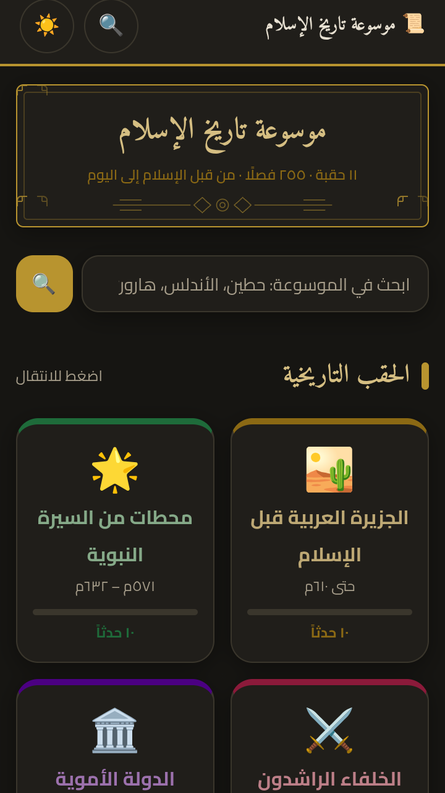
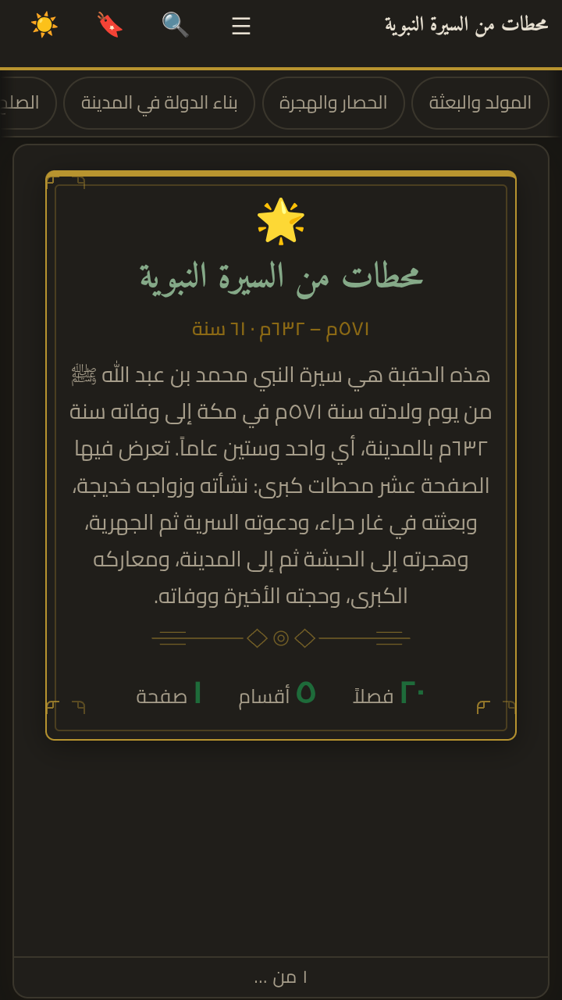
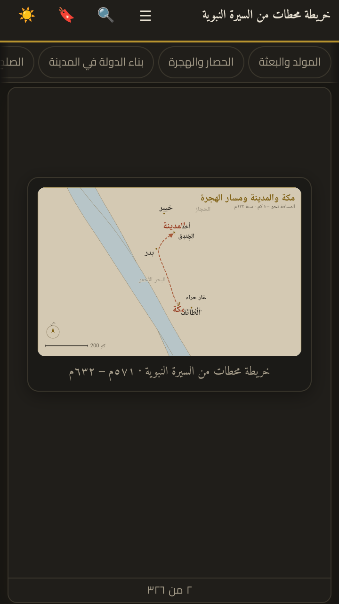

<div align="center">

# موسوعة تاريخ الإسلام

**موسوعة عربية في تاريخ الإسلام — تعمل بالكامل دون اتصال بالإنترنت**

١١ حقبة · ٢٥٥ فصلًا · قرابة ١٥٢ ألف كلمة · بلا إعلانات ولا حسابات ولا جمع بيانات

</div>

---

## ما هذا المشروع

تطبيق أندرويد وموسوعة نصّية واحدة، موزّعة على إحدى عشرة حقبة تاريخية من جزيرة
العرب قبل الإسلام إلى العصر الحديث. المحتوى كامل داخل التطبيق، ولا يتصل بأي
خادم عند الاستعمال.

| البند | القيمة |
|---|---|
| الاسم الباكيجي | `com.tarikh.islam` |
| الإصدار | 1.3.1 (`versionCode 10301`) |
| أقل أندرويد | ٧٫٠ (API 24) |
| هدف البناء | API 36 (أندرويد ١٦) |
| الصلاحيات | `INTERNET` فقط، ويضيفها إطار Cordova ولا يستعملها التطبيق |
| اللغات | العربية (RTL) بالكامل |

## المزايا

- **قراءة على شكل صفحات** لا تمرير لا نهائي: تُقسَّم كل حقبة إلى صفحات بمقاس
  الشاشة وحجم الخط المختار، فيعرف القارئ موضعه وكم بقي له.
- **بحث شامل** يتجاوز اختلاف رسم الهمزة والألف المقصورة والتاء المربوطة
  والتشكيل والأرقام الهندية، فيجد «الاندلس» و«الأندلس» و«الأندلُس» بالنتيجة نفسها.
- **إحدى عشرة خريطة تاريخية** مرسومة SVG داخل الصفحات، لا صور خارجية.
- **حفظ موضع القراءة** واستئنافه عند فتح التطبيق.
- **مفضلة وأوسمة** تُمنح عند إتمام كل حقبة، و**وضع ليلي** كامل.
- **شاشة «عن التطبيق»** تجمع سياسة الخصوصية وبيانات الإصدار داخل التطبيق.

## الخصوصية

لا حسابات، ولا إعلانات، ولا أدوات تحليل، ولا جمع بيانات. لا يُحفظ إلا موضع
القراءة والمفضلة والإعدادات، على الجهاز وحده، ويُمحى بمسح بيانات التطبيق أو
إلغاء تثبيته.

- السياسة داخل التطبيق: شاشة «عن التطبيق».
- نسخة مستقلة: [`privacy/index.html`](privacy/index.html)
- منشورة على: <https://tarikh-islam-privacy.apps.workbuddy.host/?sharecode=SQ4CWMNFQB>

## بنية المشروع

```
data/            مصدر المحتوى: حقب وفصول بصيغة JSON
assets/          التنسيقات والسكربتات والخطوط والخرائط
tools/site.js    مولّد الصفحات (يقرأ data/ ويبني ١٣ صفحة)
tools/           الفحوص: الروابط، المحتوى، البحث، المفضلة، الاستئناف، الدخان
mobile/app/      مشروع Cordova (config.xml + www المولّدة)
store/           أصول المتجر: أيقونة، صورة عرض، لقطات، نصوص الوصف
docs/            دليل التوقيع والإصدار
```

## البناء

```bash
# ١. توليد الصفحات من المصدر
node tools/site.js

# ٢. الفحوص
node tools/audit-links.js && node tools/finalcheck.js

# ٣. بناء APK وAAB موقّعين
bash tools/build-release.sh
```

التوقيع يُقرأ من متغيّرات البيئة أو من `~/.tarikh-signing.env`، ولا تُكتب كلمات
السر داخل المستودع. التفاصيل في [`docs/SIGNING.md`](docs/SIGNING.md).

> مفتاح التوقيع `mobile/keys/tarikh-release.jks` **غير موجود في هذا المستودع
> ولا في تاريخه**، وهو مستثنى في `.gitignore`. فقدانه يعني استحالة إصدار تحديث
> للتطبيق نهائيًا.

## لقطات

| الرئيسية | غلاف حقبة | صفحة خريطة |
|---|---|---|
|  |  |  |

## ملاحظة

الموسوعة عمل توثيقي تاريخي، لا فتاوى ولا أحكام شرعية، وقد تختلف بعض التفاصيل
مع مصادر أخرى.
